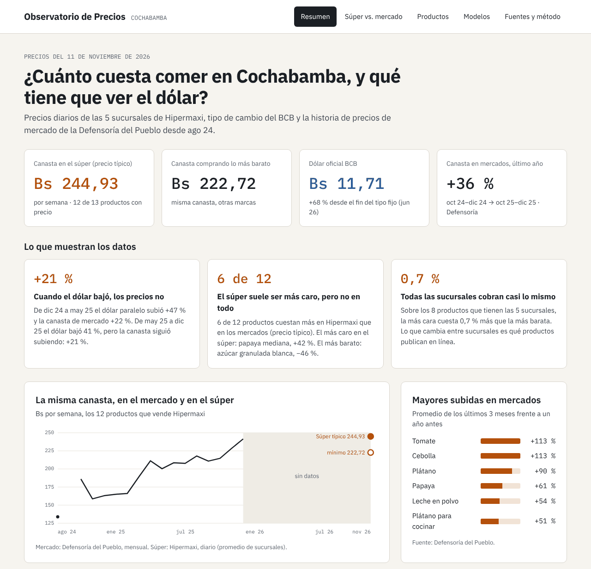
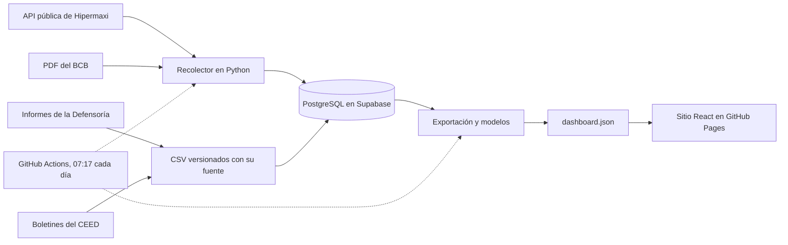
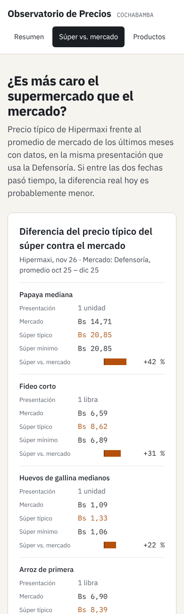

# Observatorio de Precios CBBA

¿Cuánto cuesta comer en Cochabamba, y qué tiene que ver el dólar? Este proyecto recolecta todos los días los precios de las 5 sucursales de Hipermaxi, los compara con los precios de mercado de la Defensoría del Pueblo y con el dólar oficial y paralelo, y lo publica en un sitio que se actualiza solo.

**Sitio en vivo: [mateomerino14.github.io/OBSERVATORIO-PRECIOS-CBBA](https://mateomerino14.github.io/OBSERVATORIO-PRECIOS-CBBA/)**



## Lo que muestran los datos

Con datos al 11 de noviembre de 2026:

- **Cuando el dólar bajó, los precios no.** De diciembre de 2024 a mayo de 2025 el dólar paralelo subió 47 % y la canasta de mercado 22 %. De mayo a diciembre de 2025 el dólar bajó 41 %, pero la canasta siguió subiendo: 21 %.
- **La canasta en mercados subió 36 % en un año**, sobre todo por los frescos: tomate y cebolla, +113 %.
- **El súper suele ser más caro, pero no en todo.** 6 de 12 productos cuestan más en Hipermaxi que en los mercados; la papaya, 42 % más. El azúcar, 46 % menos.
- **Las 5 sucursales cobran casi lo mismo**: 0,7 % de diferencia sobre los productos que tienen todas. Lo que cambia es qué productos publican en línea.

Las cifras del sitio se recalculan cada día desde los datos; estas son una foto.

## Cómo funciona



1. **Recolección diaria.** GitHub Actions recolecta unos 58.000 precios por día con pausas entre pedidos, respetando el `robots.txt`, y actualiza el tipo de cambio del BCB.
2. **Canasta.** Reglas versionadas en TOML emparejan los productos de la tienda con los 13 productos de la canasta de la Defensoría; el precio típico es la mediana y el económico, el mínimo.
3. **Historia.** Los precios de mercado y el dólar paralelo de 2024-2025 se extrajeron de informes en PDF y boletines, se validaron contra los totales publicados y quedaron en CSV con la fuente de cada fila.
4. **Publicación.** `observatorio exportar` arma un JSON con todo lo que muestra el sitio, y el sitio estático se publica en GitHub Pages después de cada recolección.

## Modelos

Tres modelos ayudan a leer los datos, sin cambiar nada por su cuenta ([detalle](docs/modelos.md)):

- **Sugerencias de emparejamiento (TF-IDF de n-gramas de caracteres).** Busca productos parecidos a los que la canasta ya acepta y explica qué regla los deja fuera. Encontró packs de huevos que faltaban y pastas sin gluten que no debían contar como fideo.
- **Grupos frente al dólar (k-means).** Agrupa los alimentos por cómo se movieron en la subida y en la bajada del dólar. Los básicos industriales devolvieron parte de la subida; los frescos siguieron subiendo.
- **Precios anómalos (z-score modificado).** Marca los meses en que un producto se movió muy distinto al resto de la canasta, descontando la inflación y el dólar que mueven a todos. Separa saltos reales (cebolla +140 % en un mes) de probables errores del sondeo.



## Pantallas

| Pantalla | Pregunta |
|---|---|
| Resumen | ¿Cuánto cuesta la canasta hoy y qué pasó con el dólar? |
| Súper vs. mercado | ¿Es más caro el supermercado, producto por producto? |
| Productos | ¿Qué productos de la tienda cuentan para cada ítem y a cuánto? |
| Modelos | ¿Qué se les escapa a las reglas, qué alimentos se movieron igual y qué precios saltaron? |
| Fuentes y método | ¿De dónde sale cada número y con qué supuestos? |

## Fuentes

| Fuente | Qué se toma | Estado |
|---|---|---|
| Hipermaxi (5 sucursales de Cochabamba) | Nombre, categoría, presentación, precio, oferta y stock | Diario desde nov 2026 |
| Banco Central de Bolivia | Tipo de cambio oficial diario (desde 2008) | Diario |
| Dólar paralelo (CEED de CADECOCRUZ) | Cierre mensual aproximado (ago 2024 – dic 2025) | Cargado ([detalle](fuentes/dolar_paralelo/README.md)) |
| Defensoría del Pueblo | Precios de mercado mensuales de 21 alimentos en Cochabamba (ago 2024 – dic 2025) | Cargado ([detalle](fuentes/defensoria/README.md)) |
| IC Norte | — | Descartada: su sitio actual solo muestra promociones y toma pedidos por WhatsApp |
| Fidalga | — | Descartada para Cochabamba: su tienda en línea es solo de Santa Cruz |

## Stack

| Capa | Tecnología |
|---|---|
| Recolección | Python 3.12, httpx, selectolax (lexbor), pdfplumber |
| Datos | PostgreSQL (Supabase) con migraciones versionadas y RLS |
| Modelos | scikit-learn (TF-IDF, k-means, silueta), NumPy |
| Programación | GitHub Actions con cron diario |
| Sitio | Vite, React, TypeScript, gráficos SVG propios; GitHub Pages |
| Calidad | pytest (con PostgreSQL real), Ruff, Vitest y Testing Library |

## Desarrollo

```bash
python -m venv .venv && source .venv/bin/activate
pip install -e ".[dev]"
cp .env.example .env                  # ajustar DATABASE_URL
observatorio migrar                   # crea o actualiza las tablas
observatorio recolectar hipermaxi     # recolecta los precios del día
observatorio recolectar hipermaxi --max-paginas 5   # prueba corta
observatorio recolectar bcb                   # tipo de cambio del año en curso
observatorio recolectar bcb --anios 2025 2026 # carga histórica
observatorio importar defensoria fuentes/defensoria/cochabamba.csv  # precios de mercado
observatorio importar paralelo fuentes/dolar_paralelo/cierres_mensuales.csv
pytest                                # pruebas (las de base necesitan TEST_DATABASE_URL)
ruff check . && ruff format --check .
```

## Cómo se recolecta Hipermaxi

La tienda en línea de Hipermaxi carga su catálogo desde una API pública (`/tienda-api/api/v1/public`), la misma que usa el navegador sin iniciar sesión. El recolector:

1. Busca la región de Cochabamba y sus supermercados (`markets/ciudades` y `markets/activos`).
2. Lee el árbol de categorías desde una sola página HTML de la tienda, donde Next.js lo deja embebido.
3. Para cada sucursal, pide los productos de cada subcategoría de la canasta, de 50 en 50 (`productos`).

Se recorren los rubros de alimentos, frescos, hogar, cuidado personal, frutas y granos; se dejan fuera bazar, juguetería y textiles. Si no se puede leer el árbol de categorías, se recorre el catálogo completo sin categoría.

Si la tienda responde con su verificación antibots, la corrida se detiene y queda como `bloqueada`: no se intenta saltar la protección.

## Cómo se recolecta el tipo de cambio

El BCB publica un PDF por año con la cotización oficial de cada día (`tiposDeCambioHistorico/pdf.php?anio=AAAA`). El lector ubica cada número bajo la columna de su mes por su posición en la página, porque los días sin cotización dejan celdas vacías que corren las columnas si se lee como texto plano.

- Hasta el 26 de junio de 2026 la tabla trae venta y compra; desde el 27 de junio, con el régimen flexible, un solo valor oficial, que se guarda como venta.
- Se respeta el `Crawl-delay: 10` del robots.txt del BCB.
- Cada corrida diaria vuelve a leer el año en curso, así que también recoge correcciones del BCB.

## Recolección automática

El flujo [`recolectar.yml`](.github/workflows/recolectar.yml) corre todos los días a las 07:17 (hora de Bolivia) desde `main`: aplica las migraciones pendientes, recolecta los precios de Hipermaxi y después actualiza el tipo de cambio del BCB. También se puede lanzar a mano desde *Actions → Recolección diaria → Run workflow*, con un límite de productos para probar.

Necesita el secreto `DATABASE_URL` del repositorio (*Settings → Secrets and variables → Actions*), apuntando a una base PostgreSQL accesible desde internet (por ejemplo, Supabase o Neon).

Cada corrida queda registrada en la tabla `ejecucion` con su estado (`completada`, `con_errores` o `fallida`) y la cantidad de páginas procesadas. Si fallan 20 páginas seguidas, la corrida se detiene: casi siempre significa que la tienda cambió su sitio.

## Canasta

El costo diario se mide sobre la canasta básica de alimentos de la Defensoría del Pueblo (13 productos, familia de cuatro, una semana), para compararla con el sondeo mensual que la Defensoría hace en mercados. Cada producto de la canasta se empareja con los productos de la tienda mediante reglas en [`canastas/defensoria_semanal.toml`](canastas/defensoria_semanal.toml), y las vistas `precio_canonico_diario` y `costo_canasta_diario` calculan el precio típico (mediana) y el económico (mínimo).

```bash
observatorio canasta revisar canastas/defensoria_semanal.toml   # qué producto quedó en cada ítem
observatorio canasta sugerir canastas/defensoria_semanal.toml   # qué se les escapa a las reglas
```

Detalle, supuestos y limitaciones en [`docs/canasta.md`](docs/canasta.md).

## Dashboard

Sitio estático en [`web/`](web) (Vite, React y TypeScript) con cinco pantallas: resumen, súper vs. mercado, productos, modelos y fuentes. No consulta la base: `observatorio exportar` genera un JSON con todo lo que muestra, y el flujo [`sitio.yml`](.github/workflows/sitio.yml) lo construye y publica en GitHub Pages después de cada recolección diaria.

```bash
observatorio exportar --canasta canastas/defensoria_semanal.toml --salida web/public/data/dashboard.json
cd web && npm install && npm run dev   # http://localhost:5173
npm test                               # pruebas del sitio
```

## Carga histórica

Los datos que no se recolectan a diario (tipo de cambio de años anteriores, precios de la Defensoría y dólar paralelo) se cargan con el flujo [`cargar-historico.yml`](.github/workflows/cargar-historico.yml), que se lanza a mano desde *Actions → Carga histórica → Run workflow*. Es idempotente.

## Documentación

- [`reglas.md`](reglas.md): ramas, commits y estándares de código
- [`docs/modelo-datos.md`](docs/modelo-datos.md): tablas y decisiones del modelo
- [`docs/canasta.md`](docs/canasta.md): cómo se calcula el costo de la canasta
- [`docs/modelos.md`](docs/modelos.md): sugerencias de emparejamiento y precios anómalos
